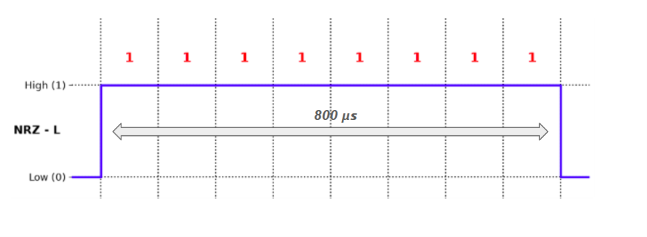
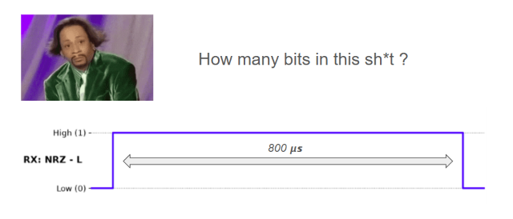
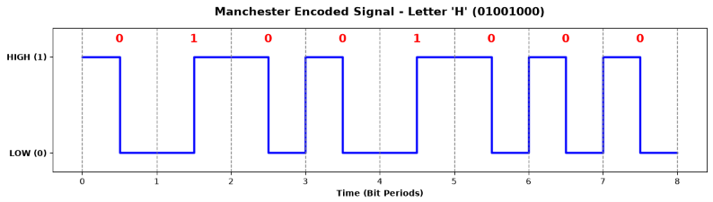
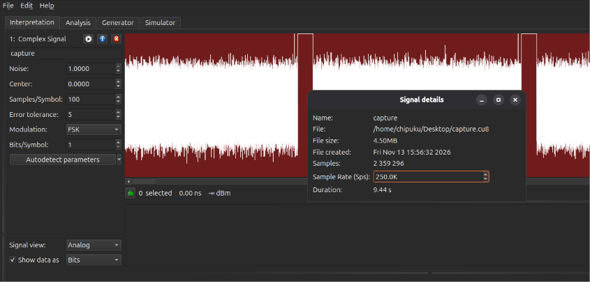
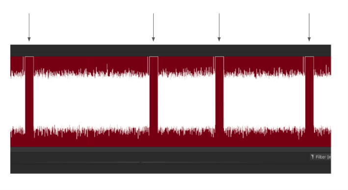
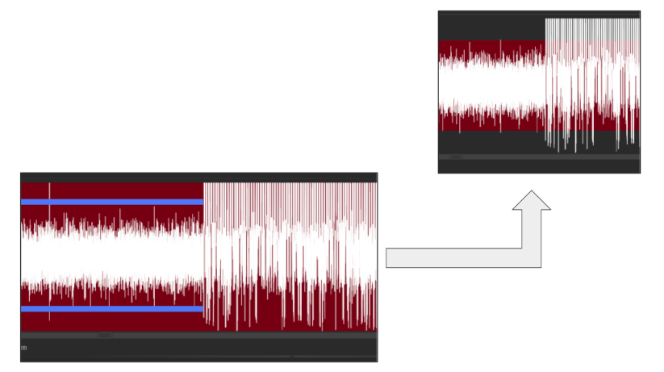
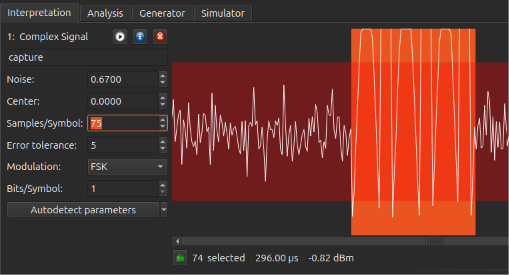
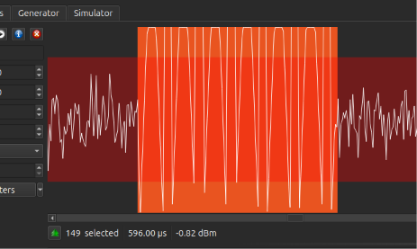
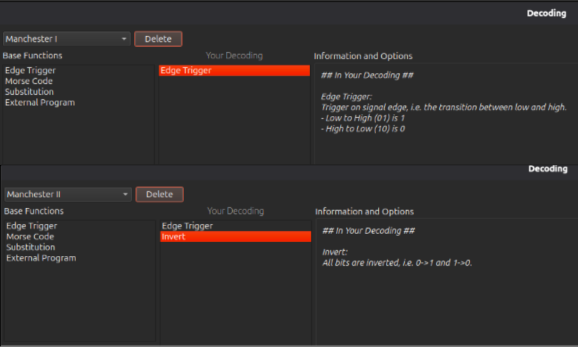

# Whyyy...
## The problem

Imagine you are transmitting the byte `0xFF (11111111)`, where each bit takes 100 µs to transmit. After $800\mu s$, the transmitter finishes sending the entire byte.

<div align="center">



*Transmitter side...*

</div>

During this time, the receiver sees a continuous `HIGH (1)` signal... 

<div align="center">



*Receiver side...*

</div>

But here is the problem: How does the receiver know where one bit ends and the next bit begins? Since the signal remains `HIGH` throughout the entire transmission. Without a shared clock or another synchronization mechanism, the receiver may lose track of bit timing.

## The solution

Yeah, we could add a bit before and after sending our byte. For example, let’s say we pick a `LOW (0)` for the start bit and a `HIGH (1)` for the stop bit. The 0xFF byte would become something like this: `0 + 11111111 + 1`. The transition from `0` to `1` gives the receiver a reference point to start its timer, right?

For a single byte, that actually works fine — the receiver only needs to stay in sync for ~10 bits. But a keyfob doesn’t send one byte, it sends a whole burst: 8, 10, 12+ bytes back to back. What if the payload is `0x00 0x00 0x00 0x01`? The signal looks like `0 + 00000000 00000000 00000000 00000001 + 1` — 32 LOW bits in a row (counting the start bit) with no edges at all. And the keyfob runs on a cheap oscillator that drifts with temperature and battery voltage, so a tiny timing error adds up bit after bit until the receiver samples the wrong one.

One reference point at the start isn’t enough. Since we can’t rely on the data to give us timing, we have to embed the clock directly into the signal itself. This is where `Manchester Encoding` comes to the rescue.

<div align="center">


*C'mon do something Manchester...*

</div>

# What is Manchester Encoding/Decoding??
## The core concept

The idea is simple: instead of representing a bit as a constant voltage level (`HIGH` or `LOW`) for the entire duration of the bit, it represents a bit as a transition (an edge) that happens exactly in the middle of the bit period.

Because every single bit forces the signal to flip in the middle, the receiver always gets a clear physical reference point to resynchronize its timer. It doesn't matter if you send a thousand `0` or a thousand `1` in a row, the signal will keep bouncing up and down. The term for this is **self-clocking** signal.

## The details

To make this happen, we basically convert a data bit to a **chip**. So what is a `chip`? A `chip` is the unit that makes up a bit; 2 chips are used for 1 data bit. For example: Data bit `1` can be represented by `01`; `0` can be represented by `10` (`IEEE 802.3`).

Let's play a fun game. I need to send a string `"Hello"`. We're gonna use `Manchester`, let's do it:
- Step 1 - Break the string down:
    - Ascii: `"Hello"`.
    - Hex: `48 65 6c 6c 6f`.
    - Binary: `01001000 01100101 01101100 01101100 01101111`.
- Step 2 - Convert data bits to chips:
    - `H`: `01001000` = `10 01 10 10 01 10 10 10`.
    - `e`: `01100101` = `10 01 01 10 10 01 10 01`.
    - `l`: `01101100` = `10 01 01 10 01 01 10 10`.
    - `l`: `01101100` = `10 01 01 10 01 01 10 10`.
    - `o`: `01101111` = `10 01 01 10 01 01 01 01`.
- Step 3 - Create a signal and send...
    - Try it yourself, I leave my script here:

    ```python
    import matplotlib.pyplot as plt

    data_bits = [0, 1, 0, 0, 1, 0, 0, 0]

    x = []
    y = []

    for i, bit in enumerate(data_bits):
        if bit == 1:
            chips = [0, 1]
        else:
            chips = [1, 0]
        
        x.extend([i, i + 0.5])
        y.extend([chips[0], chips[0]])
        
        x.extend([i + 0.5, i + 1])
        y.extend([chips[1], chips[1]])

    plt.figure(figsize=(12, 3.5))
    plt.plot(x, y, color='blue', linewidth=2.5, solid_capstyle='round')

    plt.ylim(-0.2, 1.3)
    plt.yticks([0, 1], ['LOW (0)', 'HIGH (1)'], fontweight='bold')
    plt.xticks(range(len(data_bits) + 1))
    plt.xlabel("Time (Bit Periods)", fontweight='bold')

    for i in range(len(data_bits) + 1):
        plt.axvline(x=i, color='gray', linestyle='--', linewidth=1)

    for i, bit in enumerate(data_bits):
        plt.text(i + 0.5, 1.15, str(bit), 
                horizontalalignment='center', 
                color='red', 
                fontsize=14, 
                fontweight='bold')

    plt.title("Manchester Encoded Signal - Letter 'H' (01001000)", fontsize=14, fontweight='bold', pad=15)

    plt.tight_layout()
    plt.show()
    ```

<div align="center">



*Manchester Encoded for letter H*

</div>

The receiver will capture the signal and do the reverse to recover the data bits.

# Get your hands dirty !!
## Setup & Capture

Enough of boring theory, let's dive into a real-life case. We're gonna capture some real signal from my friend's keyfob (lmao hope I don't break it). The device I use is `RTL-SDR v4` - a great tool for beginners (like me), especially because it features a built-in `TCXO (Temperature Compensated Crystal Oscillator)`. If you've played with older or cheaper SDRs, you know the pain of frequency drift as the hardware heats up. With the v4, it automatically compensates for the crystal oscillator's drift. This means no more crying over manually tuning the PPM offset. We just plug it in, tune straight to our target frequency and it stays perfectly locked on.

I use this command to capture, or you can use my captured file ([attached](/blogs_file_attached/Manchester/capture.cu8)):

```
rtl_433 -f 434.4M -s 250k -g 40 -w capture.cu8 -A -F kv -M time:iso -M level
```

## URH tool
### Tweaking the tool

`URH` or `Universal Radio Hacker` is a powerful tool that helps us process signals. Let's load the file into it. First, let's correct the sample rate. The sample rate basically means *"how many samples are captured in 1 second"*. In this example, `250,000` samples will be captured in 1s.

<div align="center">



*Correct the sample rate*

</div>

The red zone is the ignored zone (noise floor). We need to tweak it to get some data. I press the keyfob 4 times, so in URH we will see something happen, like this:

<div align="center">



*4 bursts of signal appear*

</div>

As you can see, before the first burst, there is no actual signal. Therefore, any signal happening before this first burst is considered **Noise**. So we slowly decrease the `Noise` amount to shrink the red zone until it only covers that noise. I use `Noise = 0.67`. Also, just by looking at the waveform, we can clearly see this is `On-Off Keying (OOK)` modulation. Basically: power present = `1`, no power = `0`.

<div align="center">



*Tweaking noise...*

</div>

Continuing to zoom in, we can measure **how many samples (or time) represent 1 symbol**. Hold on, what is a Symbol? Is it a Bit? So basically, Symbol is the actual physical signal sent over the air. Because we are using Manchester encoding (where 1 Bit = 2 Chips), the shortest physical pulse we see on the screen is actually just a Chip. So in this case, 1 Symbol = 1 Chip.

By highlighting the shortest pulse, we can see that `73-75` samples represent 1 symbol. So we use `75` for the `Samples/Symbol`.

<div align="center">



*We use 75 for Samples/Symbol*

</div>

### Analyzing what we got

How can we tell it's using `Manchester`? Look at the longest and shortest pulse, the shortest is around 73-75 samples (above) and the longest is around 148-152 samples. The ratio is 1:2. What does this mean? Imagine you send data `10`, in chips it looks like `0110`. In the middle, there are 2 `HIGH` chips back-to-back, so the power stays ON for 2x the duration. If there are no pulses longer than this 2x duration, it’s a strong hint you’re looking at `Manchester` encoding.

<div align="center">



*The longest pulse*

</div>

Okay, now we move to the `Analysis` tab. Go to `Decoding -> ...` to get more details. You can see in the `Manchester I`, it treats `Low-to-High (01) as 1` and `High-to-Low (10) as 0` (just like we talked about earlier). `Manchester II` is the same but it has an `Invert` step at the end, meaning `Low-to-High (01) as 0` and `High-to-Low (10) as 1`.

<div align="center">



*Decoding details*

</div>

Now we select the 4 bursts, then choose `Decoding: Manchester I`. Showing the data in Hex, here is what we get:
+ 00000000000000000000000000000000000000000000000000000150e300052c9dea25b6057c43
+ 00000000000000000000000000000000000000000000000000000150e300fcde323ee30bf86f43
+ 00000000000000000000000000000000000000000000000000000150e300c712467c5feb3cc043
+ 00000000000000000000000000000000000000000000000000000150e300ac188f5df0308e7643

This car uses a `Rolling Code` system. That means every time we press the button, it will send a different data payload (to prevent replay attacks). However, if you look closely, some parts stay completely fixed, like the `0150e300` and the `43`. My guess is that `0150e300` is the Transmitter ID (start bytes) and `43` is an end byte.

# Conclusion

A funny question: `Manchester` converts 1 bit data to 2 chips. Therefore, it consumes 2x the bandwidth and takes more time to transfer compared to normal encoding. But why is it still used everywhere, from automotive keyfobs and garage doors to RFIDs? The answer is **Reliability**.

In the RF world, it's very easy for the receiver to lose sync and extract the wrong data. But with `Manchester`, because the signal must change in the middle of every bit, the receiver always has a clear reference point for self-clocking. We sacrifice bandwidth just to ensure correct data extraction, and it's totally worth it.

<div align="center">


</div>